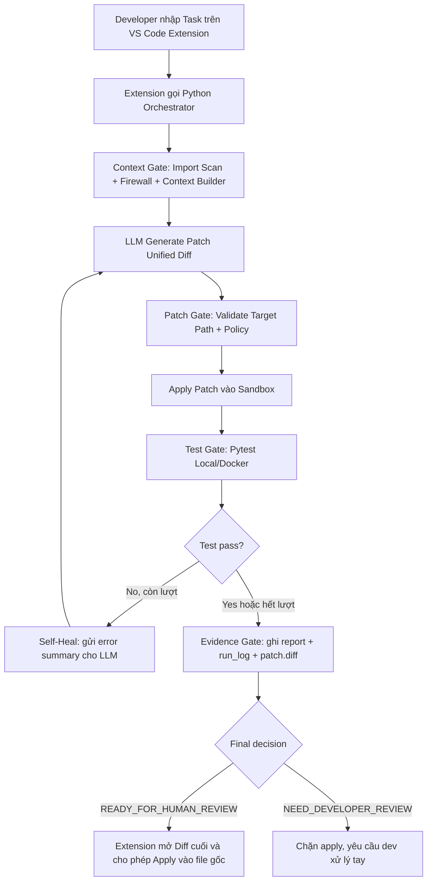

# Kiến trúc Dự án: AI Code Assembly Line (Single-Flow)

Dự án **AI Code Assembly Line** được chuẩn hóa về **một luồng duy nhất** để mọi thay đổi do AI sinh ra đều đi qua đầy đủ các cổng an toàn trước khi được phép áp dụng vào codebase.

---

## 1. Mô hình Tổng quan (Single-Flow Diagram)

Luồng chuẩn từ lúc lập trình viên nhập yêu cầu đến khi có quyết định cuối cùng:



---

## 2. Nguyên tắc Kiến trúc

1. **Một entrypoint nghiệp vụ**:
   - Extension chỉ đóng vai trò giao diện và trigger.
   - Orchestrator Python là nơi điều phối toàn bộ logic kiểm duyệt.

2. **Không apply trực tiếp trước khi qua Gate**:
   - Patch chỉ được áp vào sandbox trong quá trình kiểm thử.
   - Chỉ khi trạng thái cuối là `READY_FOR_HUMAN_REVIEW` mới cho phép apply vào file gốc.

3. **Một chuẩn output kiểm toán**:
   - Mọi lượt chạy đều ghi thống nhất vào `outputs/run_log.json`, `outputs/evidence_report.md`, `outputs/patch.diff`.

---

## 3. Thành phần chính trong Single-Flow

| Layer | Thành phần | File chính | Vai trò |
| :--- | :--- | :--- | :--- |
| UI Trigger | VS Code Extension | `vscode-extension/extension.js`, `vscode-extension/package.json` | Nhận task, gọi orchestrator, hiển thị diff cuối, nhận quyết định user |
| Pipeline Core | Orchestrator CLI | `src/assembly_line/main.py`, `src/assembly_line/orchestrator.py` | Điều phối tuần tự 4 gate + self-heal |
| Context Gate | Scanner + Firewall + Builder | `src/assembly_line/graph/import_scanner.py`, `src/assembly_line/context/context_firewall.py`, `src/assembly_line/context/context_builder.py` | Thu thập context liên quan, lọc file nhạy cảm, prune nội dung |
| LLM Layer | Client Factory | `src/assembly_line/llm/factory.py`, `src/assembly_line/llm/client.py`, `src/assembly_line/llm/mock_client.py`, `src/assembly_line/llm/external_patch_client.py` | Sinh patch vòng đầu và các vòng self-heal |
| Patch Gate | Validator + Applier | `src/assembly_line/patch/patch_validator.py`, `src/assembly_line/patch/patch_applier.py` | Xác thực patch hợp lệ/chính sách và áp patch vào sandbox |
| Test Gate | Sandbox Runner | `src/assembly_line/sandbox/test_runner.py` | Chạy pytest, hỗ trợ Docker, trích xuất lỗi phản hồi |
| Evidence Gate | Reporter | `src/assembly_line/report/evidence_report.py` | Xuất chứng cứ kiểm duyệt và quyết định cuối |
| Policy | Security/Runtime Policy | `configs/policy.yaml` | Cấu hình deny pattern, timeout, retry, docker, final decision |

---

## 4. Quy trình 4 Gate chuẩn hóa

```
Context Gate -> Patch Gate -> Test Gate -> Evidence Gate
```

1. **Context Gate**:
   - Quét file liên quan theo import graph.
   - Chặn file nhạy cảm qua deny globs/regex.
   - Tạo optimized context để giảm token.

2. **Patch Gate**:
   - Kiểm tra định dạng unified diff.
   - Chặn patch vào `.env`, `secrets/*`, `*.pem`, `*.key`, path traversal.

3. **Test Gate + Self-Heal**:
   - Áp patch vào sandbox và chạy pytest.
   - Nếu fail thì tóm tắt lỗi và gửi lại LLM để sửa, tối đa $N$ lượt.

4. **Evidence Gate**:
   - Ghi đầy đủ artifact và metadata engine.
   - Trả về một trong hai quyết định:
     - `READY_FOR_HUMAN_REVIEW`
     - `NEED_DEVELOPER_REVIEW`

---

## 5. Hợp đồng tích hợp Extension <-> Orchestrator

1. Extension gọi duy nhất một command orchestrator (CLI hoặc service API).
2. Extension **không tự apply patch** trước khi nhận verdict từ orchestrator.
3. Extension chỉ hiển thị diff cuối từ patch đã qua 4 gate.
4. Dữ liệu run summary trên UI đọc trực tiếp từ `outputs/run_log.json` chuẩn.

---

## 6. Trạng thái đích sau khi chuẩn hóa

- Không còn hai luồng độc lập gây lệch hành vi.
- Toàn bộ thay đổi AI đều đi qua cùng một pipeline kiểm duyệt.
- Dễ audit, dễ CI/CD gate, và nhất quán giữa local, extension, và CLI.
